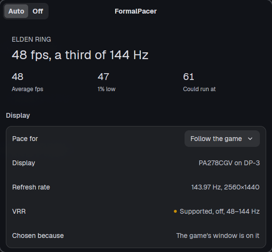
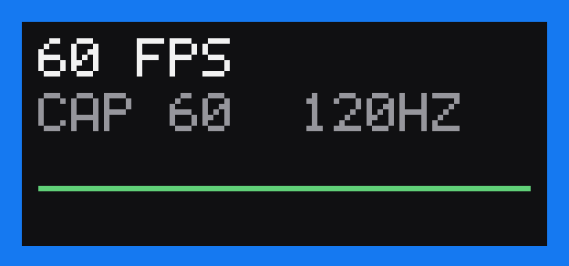

<p align="center"></p>

# FormalPacer

Console-style frame pacing for Linux and Windows games. FormalPacer watches the game you are playing, works
out what frame rate it can actually hold on the display it is on, and caps it there, so frames
arrive at an even rhythm instead of whenever they are ready. Rust on
[NativeDesktop](https://github.com/FormalStudio/NativeDesktop) (GPUI on Linux), with a tray item,
a small window and an in-game overlay.



```
┌──────────────────────────┐  /dev/shm page per game  ┌───────────────────────────────────┐
│ game (Vulkan, DXVK,      │  frame times ──────────▶ │ formalpacer (nd, GPUI)            │
│ VKD3D-Proton, OpenGL)    │                          │ engine thread: displays (DRM),    │
│  └ formalpacer layer     │ ◀── cap, overlay, VRR    │ the game's monitor, the planner   │
│    sleeps to the cap,    │                          │ tray item, window                 │
│    draws the overlay     │                          │                                   │
└──────────────────────────┘                          └───────────────────────────────────┘
```

An implicit Vulkan layer hooks `vkQueuePresentKHR` in every game. Before each present it sleeps
until the cap's next deadline, then records how long the frame took and how much of that was its
own sleep, which tells the app what the game could do uncapped. The app reads each display's mode
and VRR state from the kernel, finds the monitor the game's window is on, and writes the cap
back. On a 144 Hz panel, a game that renders 60 fps is held at 48 with its 1% low at 48, and one
that renders 200 fps is held at 138 with VRR on. OpenGL games get the same through a preloaded
hook on `glXSwapBuffers` and `eglSwapBuffers`.

## How it picks the cap

The planner takes the 95th percentile of the game's own frame time over the last two seconds
(what it can sustain, hitches included), keeps 8% of that in reserve, then:

| Display | Rule | 144 Hz panel, game does 200 / 100 / 60 fps |
|---|---|---|
| Fixed refresh | The largest whole fraction of the refresh rate the game can hold, so every frame stays on screen for the same number of refreshes: the console 30/40/60 rule | 144 / 72 / 48 |
| VRR on | Just under the refresh rate (`r - r²/3600`) when the game is fast, to stay inside the VRR window. Otherwise the highest steady rate in 5 fps steps, or a fraction of the refresh rate when that costs at most 10% | 138 / 85 / 48 |
| VRR on, game near the bottom of the VRR window | Never under the window: there the driver shows frames twice, which many panels show as flicker. A game that just reaches the bottom is held there with less headroom; one that cannot is not capped | |

The cap drops as soon as the game can no longer hold it and only rises after the game has held
the higher rate for five seconds, so it never hunts. A game locked to the refresh rate by vsync
is recognised as such and not mistaken for a slow one, and so is a game holding an even rate of
its own (its own limiter, or the driver's): it is capped at that rate, not 8% under it. Loading
screens and alt-tab gaps are left out of the numbers.

Some engines (BeamNG, most large ones) build the next frame on other threads while the layer
holds the present, so under a cap they look far faster than they are. When a raise has to be
taken back within ten seconds, FormalPacer stops trusting that game's numbers for raising: it
goes up one step at a time from then on, and waits 30 seconds before trying again after a failed
step, doubling up to five minutes.

## Which display

Pacing is only right for the display the game is on. The app asks, in order:

1. The display you picked in the window, if you picked one.
2. The compositor, for the game's process: Hyprland, Sway and niri.
3. The X server, for the window the game created its swapchain on (XWayland games on KDE and
   GNOME, and plain X11 sessions). The layer reports the window id.
4. The display whose mode matches the game's swapchain size, which is where a fullscreen game
   is. Two displays of the same size are told apart by which one has VRR running.
5. The display with VRR running, which compositors switch on for the fullscreen game.
6. The fastest display.

The window shows which of these decided it. VRR state is the kernel's `VRR_ENABLED` on the
display's CRTC, so "On" means VRR is running right now, not that it is allowed. The VRR range
comes from the monitor's EDID.

## Overlay



The top-left corner of the game shows the frame rate, the cap, and whether VRR is running on the
game's display with the rate the display refreshes at, over a graph of the newest frame times.
With VRR running the display refreshes once per frame, and a frame under the bottom of the VRR
window twice or more (`VRR 115HZ`). On Windows the NVIDIA driver says whether it is running right
now: a game Windows composes, under a window or Discord's overlay, is on fixed refresh however
G-SYNC is set (`VRR OFF 144HZ`). The graph is centred on the cap's
interval: a game paced evenly draws a flat line through the middle, and a frame that took a
quarter longer or more shows red. It is drawn into the game's own frames, so it shows up in fullscreen, in
screenshots and in recordings. Right Shift + F10 toggles it in game (through the X server, so
Proton and other XWayland games). The tray item and the window toggle it too, and
`formalpacer --toggle-overlay` does it from a compositor key binding, which also covers
Wayland-native games. The setting is shared by every game.

## Windows

On Windows a game is paced one of three ways, and nothing of FormalPacer's goes inside a game
that runs under a kernel anti-cheat.

- Vulkan games get the same layer as on Linux, registered for the user under
  `HKCU\SOFTWARE\Khronos\Vulkan\ImplicitLayers`, with live pacing and the overlay. The layer
  passes every call straight through in a game protected by Easy Anti-Cheat, BattlEye, Vanguard,
  Ricochet or VAC: it finds the anti-cheat's files next to the game (`EasyAntiCheat`, `BattlEye`,
  `*_EAC_EOS.exe`, `*_BE.exe`) or knows the game by name.
- Direct3D 11, Direct3D 12 and OpenGL games without an anti-cheat get a hook loaded into the
  running game (`formalpacer_inject.dll`), also with live pacing and the overlay. It hooks the
  DXGI present calls and `wglSwapBuffers`, sleeps before each present like the layer does, and
  clears the overlay into the back buffer. It goes in while the game runs, so there is nothing to
  restart, and it stays out of a game the layer is already in. 32-bit games and games running as
  administrator are out of its reach.
- Anti-cheat games like Fortnite, and any game the hook cannot get into, are measured from
  outside through Event Tracing for Windows with Intel's
  [PresentMon](https://github.com/GameTechDev/PresentMon). With
  [RTSS](https://www.guru3d.com/download/rtss-rivatuner-statistics-server-download/) running,
  their cap goes to RTSS's frame rate limiter, which changes it from the next frame like the
  layer does. FormalPacer writes the limit into the game's RTSS profile and puts the profile back
  when the game exits. RTSS's profiles sit under Program Files, so FormalPacer asks once for an
  administrator to let you write them. RTSS's wait counts as the frame's work to PresentMon, so
  under an RTSS cap a game looks exactly as fast as the cap and only the rate it reaches counts:
  a game that holds the cap for five seconds gets one about a quarter higher (a step at a time
  once a raise has failed, with the waits above), and one that stays under it for longer than a
  hitch lasts is capped 8% under what it reaches, so it runs with room to spare like any other.
  A drop far under the cap (a loading screen) does not have to be climbed back out of: once the
  game holds the lower cap, the one from before the drop comes back at once.
  The overlay goes into RTSS's on-screen display, drawn inside the game's own frames.
- Without RTSS, the cap goes to the NVIDIA driver's frame rate limiter in the game's driver
  profile (Max Frame Rate in the NVIDIA app). The driver reads the profile when a game starts, so a cap
  planned during one run holds from the next launch, and the window says what the driver holds
  for the run now going. Within a run that cap only goes up, so a menu or lobby running slower
  than play never becomes the next run's cap. Only a game that has been in the foreground gets a driver cap, and
  switching pacing off puts back the limit each game had before. Their overlay is a window of
  FormalPacer's own over the game's corner, on top, unfocusable and transparent to clicks, shown
  while the game is in front; its cap is what the driver holds for this run, with a third line
  ("RELAUNCH FOR CAP 138") once the next launch will get a different one. Any window over a game
  makes Windows compose the game instead of letting it flip on its own, and G-SYNC in its default
  fullscreen-only mode then stays off, so this window is left out while VRR is running. Discord's
  in-game overlay is such a window over every game, and keeps G-SYNC off while it is enabled.

RTSS and Special K hook anti-cheat games too. Anti-cheats let RTSS do that because its DLLs are
signed and on their allow lists; an unsigned DLL in Fortnite is exactly what Easy Anti-Cheat looks
for, and Valve banned CS2 players in 2023 for AMD's Anti-Lag+, which hooked the game's DLLs. Event
tracing and the driver's own limiter touch no game process, and FormalPacer only edits RTSS's
profiles, never the game. The NVIDIA driver's limiter cannot change a running game: a test game
stayed at 200 fps on Direct3D 11, Direct3D 12 and Vulkan after its limit was set to 60 mid-run.

A game is anything presenting from where the stores install games (Steam, Epic, GOG, Xbox, Riot,
EA, Ubisoft, Battle.net), apart from their launchers and tools such as Wallpaper Engine, or
anything whose own window is in the foreground and covers its monitor. Steam and Epic games show
their store name. Displays come from the Windows display configuration (exact refresh rate, the
EDID's VRR range) and G-SYNC state from the NVIDIA driver.

Reading frame times from outside needs an administrator or a member of Performance Log Users.
FormalPacer runs as the user, so the window offers to add you to the group: one consent prompt,
then sign out and back in. Until then a game without an anti-cheat still gets the hook once its
window is in the foreground and fills its monitor.

A game's cap is planned only from frames it ran in the foreground: a game behind another window
often slows itself down, and its cap holds until it is back and three seconds of frames from the
front have come in.

Not done yet on Windows: AMD and Intel drivers have no limiter FormalPacer can set, so there
games measured from outside are measured only. The overlay is drawn on 8-bit and scRGB back
buffers; HDR10 ones get pacing without it.

## Features

- Picks up games by itself: anything Steam or Proton starts, Wine and Lutris games, and any
  `.exe`, 64-bit and 32-bit. Launchers, gamescope and the Steam client are left alone.
- OpenGL games run through `formalpacer run`: `formalpacer run %command%` in Steam's launch
  options. Vulkan games need nothing.
- Steam games show their store name, read from the library's app manifests.
- One process: the engine, the tray item and the window. It starts in the tray at login. Closing
  the window leaves pacing and the tray item running; launching FormalPacer again brings the
  window back.
- The tray item shows the game and its cap, toggles pacing and the overlay, and quits.
- `formalpacer --headless` runs the engine with no window and writes what it does to stderr.
- Follows the system: light and dark, the accent colour, and matugen palettes, live.

Not done yet: a windowed Wayland-native game on KDE or GNOME falls back to the VRR display,
since neither compositor tells another process where a window is (fullscreen ones are found by
their size). OpenGL games are not picked up without `formalpacer run`, since only a Vulkan layer
gets loaded into every game by itself.

## Install

Needs Rust 1.95 (pinned by `rust-toolchain.toml`) with the `i686-unknown-linux-gnu` target for
32-bit games (`rustup target add i686-unknown-linux-gnu`), 32-bit glibc headers (`glibc-devel-32bit`
and `gcc-32bit` on openSUSE, `lib32-glibc` on Arch, `gcc-multilib` on Debian),
[just](https://github.com/casey/just) and, to build, `libxkbcommon`, `wayland`, `vulkan-loader`,
`fontconfig`, `freetype`.

```sh
git clone https://github.com/FormalStudio/FormalPacer
cd FormalPacer
just install      # the app, both layers and the OpenGL hooks, a desktop entry and a login item
```

Start FormalPacer once (after that it starts at login), then any game. Games that were already
running when the layer went in need a restart. If the layer is not registered, the window offers
to register the one installed next to the app. `just uninstall` removes everything `install` put
down.

On Windows, with Rust 1.95 and the Visual Studio build tools:

```powershell
git clone https://github.com/FormalStudio/FormalPacer
cd FormalPacer
powershell -ExecutionPolicy Bypass -File scripts\install-windows.ps1
```

It builds the app, the layer and the hook, downloads PresentMon (pinned, hash checked), installs
them in `%LOCALAPPDATA%\Programs\FormalPacer`, registers the layer, adds FormalPacer to the Start
menu and starts it at sign-in.
`nd package windows` builds a `Setup.exe` with the same files once the script has fetched
PresentMon.

To force the layer on for a game it does not recognise, set `FORMALPACER=1` in its launch options
(`FORMALPACER=1 %command%` in Steam). `FORMALPACER=0` leaves one game alone, and
`DISABLE_FORMALPACER=1` keeps the layer out of a process entirely.

## Configuration

The window writes `~/.config/formalpacer/config.toml` (`%APPDATA%\FormalPacer\config.toml` on
Windows):

```toml
mode = "auto"        # "off" measures without capping
display = "DP-1"     # leave out to follow the game (DISPLAY1 on Windows)
overlay = true
```

On Windows it also keeps `[driver_caps]`: the games whose NVIDIA driver limit FormalPacer has set,
each with the limit it had before.

## Development

```
crates/formalpacer-shm      the shared page between layer and app
crates/formalpacer-hook     what runs in the game: detection, the limiter, the overlay, its hotkey
crates/formalpacer-layer    the Vulkan layer (cdylib): pacing and the overlay by buffer copy
crates/formalpacer-gl       the OpenGL hook (cdylib, LD_PRELOAD): pacing and the overlay by clears
crates/formalpacer-engine   displays, placement, the planner, the engine thread
src/                        the nd app: window, tray item, single instance
tools/fakegame              a Vulkan test game with a set frame rate (--background: unfocused, in a corner)
```

```sh
just dev                          # run from the checkout; FORMALPACER_DEMO=1 opens on a fixed snapshot
nd check                          # fmt, clippy, framework lints, appearance audit
nd test                           # tier 1 and 2
cargo test --workspace            # the planner, placement, EDID and the shared page
just pacing-check 200 100 60      # fakegame at each rate under the headless engine
FAKEGAME_FLAGS=--fullscreen just pacing-check
```

`just pacing-check` registers the layer from the checkout for its own runs only and prints the
rate fakegame measured next to the cap the engine chose.

## License

MIT
